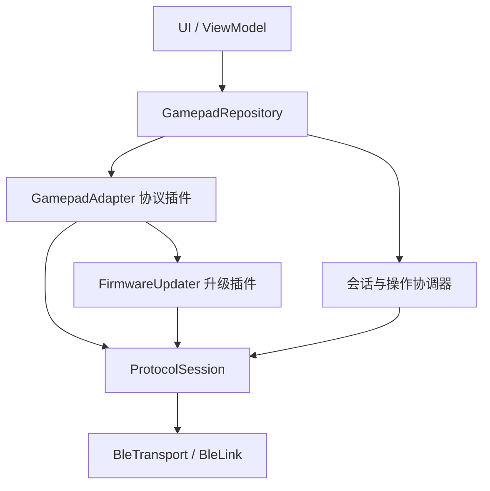

# Android BLE 手柄通信与升级封装方案

这套方案适用于使用 BLE GATT 提供厂商自定义通信/升级能力的手柄。目标是：公共基础设施实现一次，新增手柄时新增并注册一个协议适配模块，已有 UI、ViewModel 和 Repository 业务接口保持稳定。

交付内容是**封装设计、Kotlin 接口骨架和虚构协议的命令示例**，不是已经实现并完成真机测试的 SDK。`BleTransport`、`ProtocolSession`、Repository 的生产实现需要按下述契约实现；真实 UUID、鉴权和 OTA 必须来自厂商文档。本包未填入任何真实手柄命令，不会伪造可用的升级协议。

## 1. “只换协议”究竟换什么

“协议模块”不是一个 encode/decode 类，而是下面这些差异的集合：

| 内容 | 放置位置 | 新增型号时是否可能变化 |
|---|---|---|
| 扫描执行、权限检查、扫描停止 | BleScanner / Android 层 | 通常复用 |
| 扫描候选规则、型号识别 | GamepadAdapterFactory | 是 |
| 连接、服务发现、CCCD、GATT 操作队列 | BleTransport / BleLink | 通常复用 |
| Service/Characteristic UUID、通知类型、写入类型 | BleProfile / 协议模块 | 是 |
| 报文头、长度、命令、序号、校验和解析状态 | MessageDecoder / 命令构造器 | 是 |
| 请求登记、等待、超时、断连失败处理 | ProtocolSession | 复用机制 |
| 哪个响应属于哪个请求、如何解释 NACK | ProtocolRequest.match | 是 |
| 初始化、厂商鉴权、读版本、设置灯效 | GamepadAdapter | 是 |
| 进入升级模式、重连、分包、确认、重试、校验 | FirmwareUpdater | 是 |
| 对外业务接口、操作仲裁和 UI 状态 | GamepadRepository | 通常复用 |

同一 BLE 通道族内，可以把新型号的上述差异收在一个模块。增加全新业务能力时，仍可能需要扩展业务接口和界面。经典蓝牙 SPP、系统 HID、USB 不是只改 BLE UUID 就能支持；应另加对应传输实现或专用适配器。

普通按键/摇杆经 Android 输入系统交给 KeyEvent/MotionEvent，建议独立为输入模块。这套封装主要管理设备信息、设置和 OTA。

## 2. 依赖关系



第一版在同一个 Android library 内按包组织即可：api、transport、session、repository、protocol/vendorA、protocol/vendorB。不必一开始拆很多 Gradle 模块。

源码全部使用 `sample.gamepad` 包；`contracts/` 是公共契约，`examples/` 是示范。接入工程时可放到 `src/main/kotlin` 并改包名。依赖 Kotlin 标准库、JDK UUID、kotlinx-coroutines-core；依赖版本跟随现有工程，不在本设计中强行升级 AGP/Kotlin。

## 3. 公共传输层

`BleTransport.open(target, profile)` 负责：

1. 检查权限和蓝牙可用性，建立 GATT 连接。
2. 按 profile 要求处理绑定、服务发现以及特征属性验证。
3. 尝试协商 MTU，记录回调得到的实际值。允许的回退策略由配置明确规定。
4. 先安装通知回调，再完成所有必需 CCCD 写入。
5. 以上完成后才返回 BleLink；早到的通知进入有界队列。

连接成功回调不代表可发业务命令，Repository 还要等 adapter.initialize 成功才发布 Ready。

读、写、CCCD、MTU 等操作共用一条 GATT 队列。队列必须按真实完成/失败回调推进。设置为无响应写也不等于可以无限发送；发送节奏仍需满足平台、库和设备协议约束。

本层只提供字节传输，不认识“读取版本”“第 8 个固件包”“升级成功”。write 返回只代表对应传输操作完成，不等于设备业务确认。普通写的可用 value 长度要结合实际 MTU、特征与平台上限；常见 ATT 头占 3 字节，但固件 payload 还要减去厂商包头/序号/校验，并遵循厂商限制。

不要在公共传输层调用任意 split() 自动切开业务报文。协议决定一条命令能否跨多个写操作，以及每片的格式。

生产实现可以封装 Nordic Android BLE Library，让它管理 GATT 队列与回调，依然只向上暴露本包接口。它是通用 BLE 库，不意味着厂商手柄采用 Nordic DFU 协议。

Android 12+ 的扫描/连接权限、旧系统兼容权限由 Android 层统一管理；运行时请求由 Activity 或 Compose 权限入口发起，Repository 不持有 Activity。不要把系统回调简单搬到 Dispatchers.IO 就认为异步与队列问题已经解决。callbackFlow 适合桥接回调，但它本身不提供 GATT 串行化、事务关联或流控。

## 4. 会话层：把发送和响应对应起来

每次连接创建一个全新的 ProtocolSession、接收管线和 MessageDecoder。禁止多个命令分别收集底层接收 Channel；否则它们会竞争消费通知。

请求处理顺序必须是：

1. 检查会话状态，获得请求执行权。
2. 登记响应匹配器和等待者。
3. 写入请求帧。
4. 接收管线解码并根据 match 完成等待者。
5. 清理等待者并释放执行权。

不能先 write 再开始 first 等待 ACK，设备可能在 write 返回前就已经回复。不能用 replay=1 的 SharedFlow 缓存上一条 ACK 来弥补这个问题。

默认一次只允许一个请求在途。协议若有事务号，需要同时匹配命令类型与事务号；OTA 可能还要匹配 offset、包序号和设备状态。没有事务号时，互斥锁不能解决迟到 ACK：默认在发送可能开始后的超时/取消时废弃会话，由协议定义重新握手/重连恢复。不要盲目复用原连接重发。

通知回调必须复制数据再入队。ACK 不走 DROP_OLDEST/DROP_LATEST；缓冲耗尽要明确失败并关闭会话。UI 状态可以通过 StateFlow 合并，关键控制消息不能因此丢失。

取消必须保留 CancellationException。断连立即失败等待者。BleLink 和 ProtocolSession 都暴露一次性 termination 信号，空闲断连也必须完成该信号；Repository 观察它来退出 Ready，不再竞争消费底层通知队列。每次连接携带 generation；旧 GATT 回调不能影响新连接。业务操作另有 operationId，旧任务的 finally 也不能覆盖新状态。

`examples/ReadVersionExample.kt` 展示如何构建 ProtocolRequest 和按事务号匹配响应。其报文完全虚构，只用于说明边界。

## 5. 协议插件

新增一个型号，放在自己的目录中：

- VendorAAdapterFactory：候选识别与实例创建。
- VendorAAdapter：UUID/profile、握手、读信息、设置灯效。
- VendorADecoder：帧边界、长度、校验、响应对象。
- VendorACommands：构建命令和匹配响应。
- VendorAFirmwareUpdater：厂商 OTA 状态机。

简单协议可合并文件，不要求机械地创建五个类。

Factory 可为单例，但 adapter、decoder、事务号等连接状态必须每设备/会话独立。使用 AdapterRegistry 按 protocolId 创建，不在 Repository 里不断增加 if (品牌A) / else if (品牌B)。支持自动识别时，候选不唯一必须显式消歧，并在握手后验证真实型号。

不支持的功能通过 capabilities 表达，调用时抛出 UnsupportedFeatureException。不要返回空字符串或假成功。初始信息中无法查询的 firmwareVersion 可以为 null。

Hilt 注册示意（具体构造器和实现由工程提供）：

```kotlin
@Module
@InstallIn(SingletonComponent::class)
abstract class ProtocolBindings {
    @Binds
    @IntoSet
    abstract fun bindVendorA(factory: VendorAAdapterFactory): GamepadAdapterFactory

    @Binds
    @IntoSet
    abstract fun bindVendorB(factory: VendorBAdapterFactory): GamepadAdapterFactory
}

// Registry 持有 Set<GamepadAdapterFactory>，每次 create 返回新 adapter。
// 新增型号只增加自己的绑定，Repository/ViewModel 不增加品牌判断。
```

## 6. OTA 放在插件里，但状态对 UI 统一

统一对外动作：`suspend fun upgrade(firmware): UpgradeResult`。

统一对外观察：`StateFlow<UpgradeState>`。

不要用一个冷 Flow 同时承担“启动升级”和“观察进度”，多次 collect 可能启动多次升级。UI 停止收集进度，也不应自动终止由会话服务持有的升级。

升级插件拥有完整状态机：检查固件和设备兼容性 → 鉴权 → 进入 Bootloader → 必要时重新扫描与重连 → 分包和 ACK → 设备校验 → 重启 → 查询安装结果。

以下规则不应硬编码进公共升级器：进入升级命令、Bootloader UUID/地址、chunkSize=20、每包 sleep、固定重试 3 次、统一 CRC 算法、统一断点格式。

UpgradeContext 提供重新发现和替换会话的能力，但由插件判断目标身份。不能按名字连接第一个 Bootloader。若地址改变，需结合厂商标识、序列号、会话 token 或升级握手验证；无法确认时不能自动给候选设备刷固件。

本包 ProtocolSession 的 request 适合逐包确认。窗口式 OTA 可先调用 openMailbox 同步登记可靠 ACK 收件箱，再通过 write 发送一个窗口，插件自己按包序号/offset 处理窗口确认与重传，最后关闭 mailbox。不要把普通单请求模型硬套成多个并行 request，也不要让 mailbox 与 request 匹配同一批响应。窗口 ACK 走可靠 mailbox，不能依赖 UI 的 Flow 订阅。使用现成厂商 DFU SDK 时，可由 FirmwareUpdater 包装 SDK 并接管升级连接，原会话先经协调器释放；公共业务接口仍不变。

`Transferring.confirmedBytes` 依据设备确认的固件数据量，不把包头算入固件总量。如果协议仅最终确认，过程中只能显示发送阶段/估算进度或不确定进度，不能伪称逐字节已确认。

所有字节传完后，继续显示校验、重启和确认阶段。返回 Verified 才发布 Success；无法确认安装结果时返回 NeedsConfirmation，UI 显示 PendingConfirmation。

恢复必须核对设备身份、硬件版本、固件指纹和设备认可的偏移量。取消本地协程不等于设备已执行安全回滚；safeAbortUpdate 只有在厂商协议明确支持时才为 true。

FirmwareSource 由单独的文件/URI DataSource 提供，读取使用 withContext(IO) 等方式保证 main-safe；大固件不必一次全部读入内存。校验与签名验证按厂商固件规范执行，SHA-256 指纹本身不是数字签名验证。

## 7. Repository 的生命周期和并发

一个 Repository 实例管理一个设备会话。多手柄时由 Manager 创建多个实例，不共享连接、decoder、请求等待者或 OTA 状态。

Repository 需要一个操作协调器：

| 当前操作 | 外部请求 | 行为 |
|---|---|---|
| 无操作且已就绪 | 普通命令 | 取得执行权并执行 |
| 正在连接/初始化 | 连接、命令、升级 | 明确返回 Busy 或 NotReady |
| 正在升级 | 新连接、配置、重复升级 | 返回 Busy |
| 正在升级 | 插件内部 Bootloader 重连 | 保留独占权并替换会话 |
| 任意操作 | disconnect / close | 使会话失效并打断操作 |
| 正在清理断开 | 连接、命令、升级 | 返回 Busy，清理完成前不能新建会话 |
| 已永久 close | 任意新操作 | 拒绝；需要由所有者创建新的 Repository |

状态锁只用于短暂检查和替换引用，不持锁等待 GATT、ACK、重连或 cancelAndJoin。普通命令可以选择排队，但必须有明确的排队期限；本设计默认返回 Busy，避免过期的用户操作积压。

disconnect 不能排在 OTA 长时间持有的同一把 Mutex 后。建议流程：短锁内发布 Disconnecting、使 generation 失效、取出当前 operation Job 和会话 → 锁外取消任务/关闭当前及正在建立的链路 → 等待清理 → 核对操作代次后发布 Disconnected。清理期间拒绝新操作；close 设置永久 closed 标志并发布 Closed，后续清理不能将其覆盖成 Disconnected。即使调用者取消 disconnect，已开始的资源清理也必须保证完成；不可取消清理段应有时间上限。

失败后不能无条件恢复 Ready：设备可能还在 Bootloader。根据实际会话和插件检测结果发布状态。旧操作的成功、异常和 finally 都要核对 operationId，防止旧结果覆盖新连接。

如果需要后台升级，由专门的会话/前台服务持有 Repository 与 Scope；如果只支持页面内操作，可以由 ViewModel 持有。确定实际所有者后再选 DI scope，不要每个 Composable 都创建 Repository，也不要把所有可变会话做成全局单例。

UseCase 可选：单纯转发 readInfo/setLight 不需要再套一层。跨固件仓库、用户授权和设备状态的复杂升级前置业务，可提取 UpgradeGamepadUseCase。

## 8. ViewModel 调用示意

```kotlin
@HiltViewModel
class GamepadViewModel @Inject constructor(
    private val repository: GamepadRepository,
) : ViewModel() {
    val connectionState = repository.connectionState
    val upgradeState = repository.upgradeState

    fun setLight(setting: LightSetting) = viewModelScope.launch {
        try {
            repository.setLight(setting)
        } catch (e: CancellationException) {
            throw e
        } catch (e: Exception) {
            // 映射 Busy / Unsupported / LinkLost 等为页面错误状态。
        }
    }
}
```

如果由 ViewModel 拥有会话，在 onCleared 调用 close；如果由服务拥有，ViewModel 不负责关闭服务共享的会话。UI 不拼接十六进制命令，不感知 UUID、MTU 和厂商 OTA 包序号。

## 9. 新增一个手柄的实际步骤

1. 确认它的厂商通信和升级通道均为本框架覆盖的 BLE GATT 能力。
2. 从协议文档整理普通模式/升级模式 UUID、特征属性、身份和鉴权规则。
3. 实现 adapter、decoder、命令和 updater；不支持的能力标记为 false。
4. 注册新的 GamepadAdapterFactory，不改公共 Repository/ViewModel 逻辑。
5. 为厂商协议做编码、解码、响应匹配测试，再按真机验证清单联调。

新增协议主要改 vendor 目录和 DI 注册。若只是同一协议的不同型号，可以共享 codec/updater，只换 profile、能力和兼容性配置。

## 10. 高价值验证清单

- 设备在 write 返回前立即 ACK，仍正确完成请求。
- A 请求超时后迟到 ACK 不会完成 B 请求。
- 已取消 GATT 的回调不会推进下一操作；旧连接不能修改新状态。
- 断连会立即失败所有等待者，资源正确释放。
- 通知过载明确失败，无静默丢 ACK。
- MTU 变小或协商失败，协议分包仍有效。
- OTA 处理中拒绝普通配置与重复升级；disconnect 可以打断 OTA。
- Bootloader 改地址且出现同名设备时，目标身份仍正确。
- 重复/乱序 ACK、NACK、校验失败不被当成升级成功。
- 恢复使用相同设备与相同固件，并以设备确认偏移为准。
- 数据已发送但未确认安装结果时显示 PendingConfirmation。

本环境未编译这些接口，也没有 BLE 真机验证；清单是实施后的验收要求，不是已经通过的测试结果。

## 官方资料

- Android BLE 数据传输：https://developer.android.com/develop/connectivity/bluetooth/ble/transfer-ble-data
- Android 蓝牙权限：https://developer.android.com/develop/connectivity/bluetooth/bt-permissions
- Android BluetoothGatt（MTU / 读写 API）：https://developer.android.com/reference/android/bluetooth/BluetoothGatt
- Nordic Android BLE Library：https://github.com/NordicSemiconductor/Android-BLE-Library
- Nordic 使用说明：https://github.com/NordicSemiconductor/Android-BLE-Library/blob/main/USAGE.md

以上资料用于核对 Android/GATT/库能力；插件边界、状态模型和接口为本方案的设计建议。
